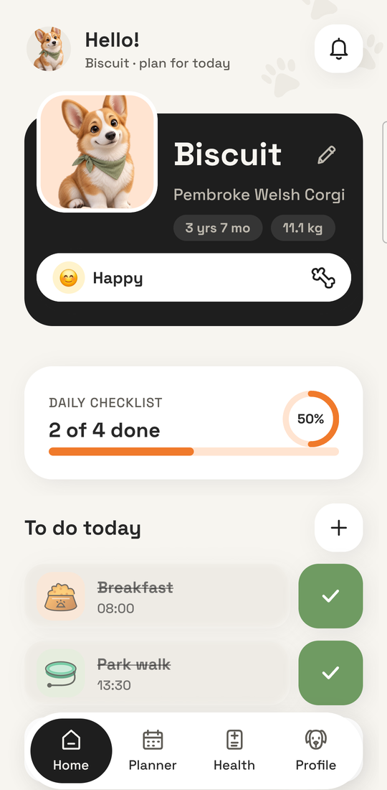
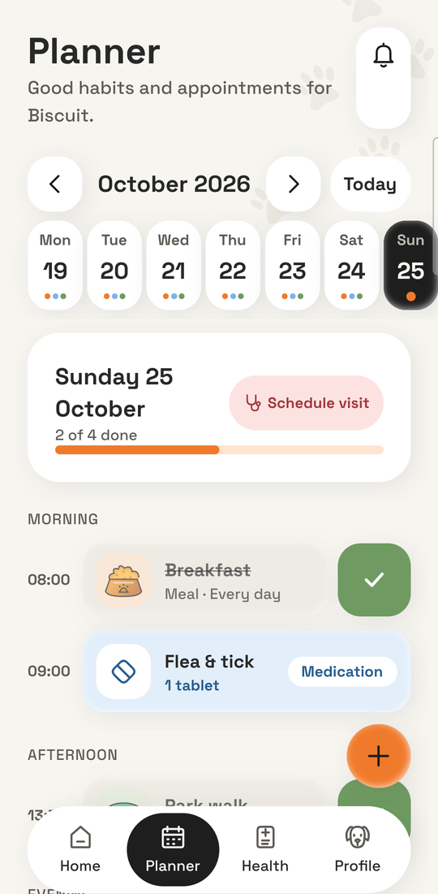
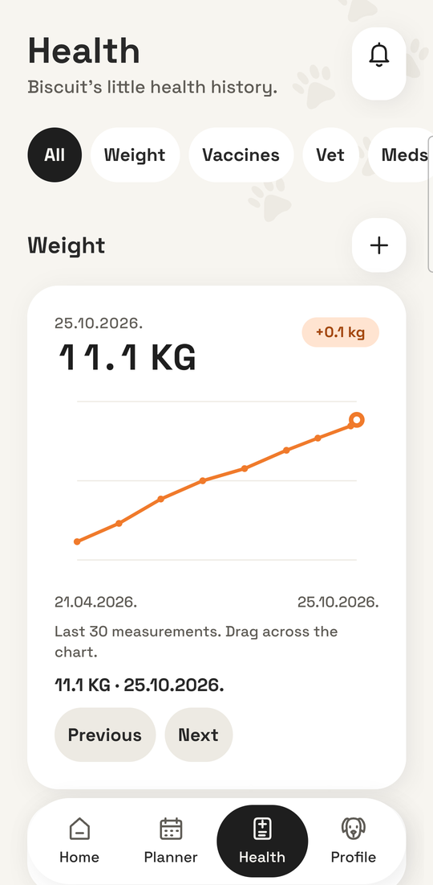
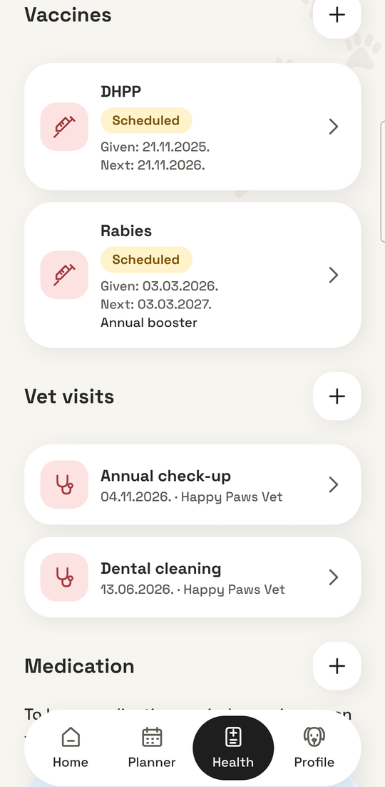
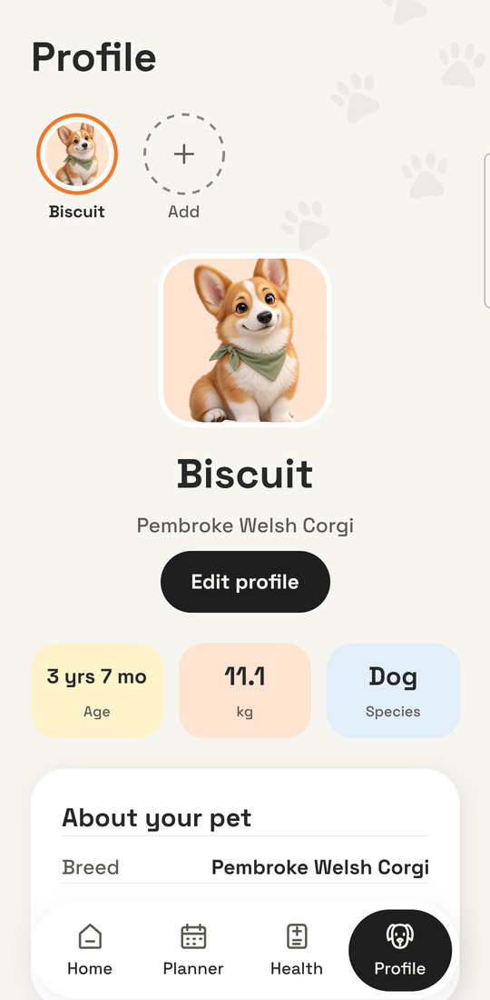

<div align="center">


# PetWarden

**PetWarden — an offline-first pet care app for Android.** Track daily care tasks, weight, vaccinations, medications, vet visits and documents for every pet: dogs, cats, rabbits, birds and more. Exact local reminders, JSON backup and restore. Built with Expo, React Native and SQLite. No account, no server, no tracking, no internet permission.

*Small habits for happy paws.*


[](https://github.com/MrS1mbaa/petwarden/actions/workflows/ci.yml)


<br />







</div>

> [!WARNING]
> **Use at your own risk.** PetWarden is a free hobby project with **no warranty**. It is not veterinary advice, reminders can be late or missed, and your data exists only on your phone. Read the [Disclaimer](#disclaimer) before relying on it. The app asks every user to accept its Terms of use before first use.

## Features

- **Home**: the daily checklist at a glance, one-tap check-in with undo, mood of the day, swipe a task to delete it.
- **Planner**: week view with recurring tasks (daily, weekdays, custom days), vet visits and medication in one timeline.
- **Health**: weight chart you can scrub with a finger, vaccines with due dates, vet visits, medication courses, allergies and notes.
- **Documents**: keep lab results, passports and invoices (PDF or photo) with the pet; open or share them.
- **Several pets**: switch between profiles; care, health and documents stay separate.
- **Reminders that are on time**: exact local alarms, re-registered after a reboot, no push service involved.
- **Your data is yours**: one JSON file exports everything (photos and documents included) and imports it back.
- **Polished details**: light, dark and system themes, English and Serbian, Reduce Motion support, scales to the largest system font.

## Privacy

Everything is stored on the phone in SQLite. The release build does not request the `INTERNET` permission, so it cannot send data anywhere, and Android Auto Backup is turned off, so nothing is copied to the cloud either. The only way data leaves the phone is a backup file you export yourself.

There are no analytics, crash-reporting or advertising SDKs. `expo-notifications` brings Google's Firebase push libraries with it; the app's manifest removes their services and receivers (`plugins/withoutFirebase.js`), and the Play install-referrer permission is blocked. Privacy questions: [open an issue](https://github.com/MrS1mbaa/petwarden/issues).

## Tech stack

| | |
| --- | --- |
| App | Expo SDK 57, React Native 0.86, React 19, Expo Router |
| Language | TypeScript (strict) |
| Data | expo-sqlite, Drizzle ORM, numbered migrations |
| UI and motion | Reanimated 4, Skia (charts, rolling digits), Lottie, Gesture Handler |
| State | Zustand |
| Notifications | expo-notifications (local only) |

Architecture notes: [docs/ARCHITECTURE.md](docs/ARCHITECTURE.md).

## Getting started

Requirements: Node.js 22.13+ and npm.

```bash
npm ci
npx expo start          # open with Expo Go (SDK 57) on an Android phone
```

Expo Go is enough for most screens. Reminders, exact alarms and release signing need a real build (see below).

| Command | What it does |
| --- | --- |
| `npm run typecheck` | `tsc --noEmit` |
| `npm run lint` | `expo lint` |
| `npm run check` | Domain checks: theme contrast, migrations, recurrence, health, planner, backup, notifications |
| `npx expo-doctor` | Dependency and config sanity |

Details: [docs/TESTING.md](docs/TESTING.md).

## Build an APK

On Windows, double-click **`Build-APK.bat`**. It generates the native project with `expo prebuild`, runs Gradle and drops `build-apk/PetWarden-local-<date>.apk` next to a SHA-256. Needs JDK 17+ and Android SDK Platform 36.

Signing, wireless install, EAS builds and the permission model: [docs/BUILDING.md](docs/BUILDING.md).

## Project structure

```
app/            Expo Router routes (thin wrappers around screens)
src/features/   care, health, planner, pets, documents
src/db/         SQLite client, Drizzle schema, migrations, repositories
src/notifications/  Pure reminder planning + native / web adapters
src/components/ Shared UI
src/lib/        Dates, i18n (en, sr), motion, haptics
src/theme/      Design tokens and themes
scripts/        Node checks and build helpers
docs/           Architecture, building, testing, asset provenance
```

## Status

A free hobby project. Android only; iOS and web code paths exist but are untested previews.

Verified end to end on a Samsung SM-S928B (Android 17) with a release APK: onboarding, check-ins, exact reminders (including after a reboot), documents, export and import, pet deletion, large-font layout, 0 – 0.6 % janky frames while scrolling and zero idle rendering.

Not yet verified: TalkBack, an airplane-mode session, iOS (the code paths are shared but nothing is tested or built for iOS).

See [CHANGELOG.md](CHANGELOG.md) for history.

## Contributing

Bug reports and small pull requests are welcome, but this is a spare-time project with no support obligation. Read [CONTRIBUTING.md](CONTRIBUTING.md) before opening an issue or a pull request. Everyone follows the [Code of Conduct](CODE_OF_CONDUCT.md).

**Security problems:** please report them privately, never in a public issue. See [SECURITY.md](SECURITY.md).

## Disclaimer

PetWarden is a free hobby project, provided **"as is", without warranty of any kind**, express or implied, including fitness for a particular purpose and non-infringement (see [LICENSE](LICENSE)).

- **Not veterinary advice.** The app helps you organise care. It does not diagnose, treat or replace a veterinarian. Follow your vet's instructions, especially for medication and doses.
- **Reminders can fail.** Battery savers, disabled notifications, operating-system updates or a force-stop can delay or cancel them. Do not rely on the app alone for time-critical care.
- **Your data is your responsibility.** Everything is stored only on your device, with no cloud copy. Uninstalling the app or losing the phone loses your data. Export a backup regularly and keep it somewhere safe; the backup file is not encrypted.
- **Self-built and modified versions.** If you build, modify or distribute the app yourself, you are responsible for that build, its signing and its distribution.

To the maximum extent permitted by applicable law, the authors and contributors are not liable for any damages arising from the use of, or inability to use, this software, including lost data, missed reminders or device problems. Nothing in this disclaimer limits liability that cannot be limited by law.

## License

[MIT](LICENSE). Third-party packages keep their own licenses: see [THIRD_PARTY_NOTICES.md](THIRD_PARTY_NOTICES.md). The full license text of every bundled npm package and Android library is in [`licenses/`](licenses). Fonts: Space Grotesk by Florian Karsten, SIL Open Font License 1.1 ([assets/fonts/OFL.txt](assets/fonts/OFL.txt)); Material Symbols by Google, Apache License 2.0 (used by Expo Router). Illustrations, icons and animations are original to this project: see [docs/ASSETS.md](docs/ASSETS.md).
